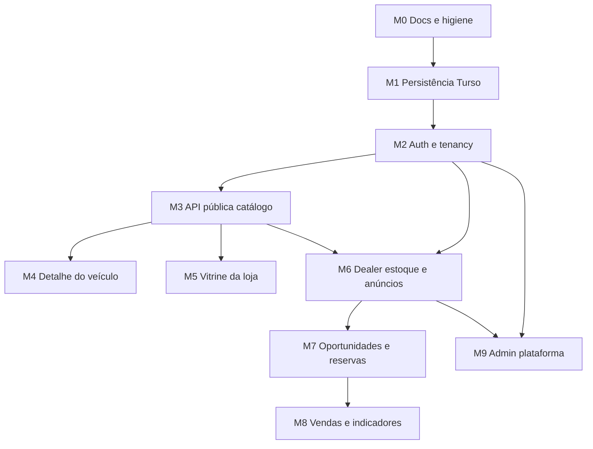

# Roadmap de implementação incremental — MyCars

**Base:** [implementation-audit.md](./implementation-audit.md)  
**Princípio:** preservar Home, listagem, design system e contratos públicos; evoluir atrás de services e camadas server.

---

## Visão dos marcos

---

## M0 — Higiene documental e alinhamento

**Objetivo:** docs e rules refletirem o MyCars (não o legado Twitch/Streaminhub).

**Dependências:** nenhuma.

**Trabalho**
- Revisar `ARCHITECTURE.md`: remover Twitch/IGDB/bot/economy/raffles; descrever domínios automotivos.
- Arquivar ou remover `docs/REFACTORING.md` (Streaminhub).
- Ajustar exemplos em `docs/project-standards-nextjs.md` / rules que citam BotCommands.
- Linkar este roadmap e a auditoria no `README.md`.

**Critérios de conclusão**
- [ ] Nenhum doc “oficial” descreve APIs Twitch/bot inexistentes.
- [ ] README aponta auditoria + roadmap.
- [ ] Rules Cursor alinhadas aos domínios MyCars (ou marcadas “quando existir pasta”).

---

## M1 — Persistência Turso + Drizzle

**Objetivo:** banco compartilhado com isolamento lógico por `store_id`; schema versionado.

**Dependências:** M0 (recomendado).

**Trabalho**
- Instalar `@libsql/client`, `drizzle-orm`, `drizzle-kit`, `zod`.
- `src/shared/lib/db/` — client, schema, migrations.
- Tabelas mínimas: `stores`, `users` (stub se auth vier em M2), `store_memberships`, `vehicles`, `listings`, `vehicle_media` (opcional).
- Separar **vehicle** (estoque) de **listing** (publicação); DTO público permanece join.
- Seed a partir de fixtures (script isolado, não misturar com runtime de produção).
- Repository + service de leitura pública (`listVehicles`, `getVehicleBySlug`) atrás da mesma assinatura dos stubs **ou** feature flag `USE_FIXTURES`.

**Critérios de conclusão**
- [x] Migrations aplicáveis em Turso local/remoto.
- [x] Integridade: FKs, índices (`store_id`, slug únicos por escopo), unicidade documentada.
- [ ] `isPubliclyListable` continua a regra única de exposição (agora sobre rows reais).
- [ ] Home e `/veiculos` funcionam com DB **ou** fixtures via toggle explícito.
- [x] Sem mudança visual obrigatória.

**Entregue em M1 (fundação):** schema + migrations + repos/services + seed + testes de persistência — ver [docs/database.md](./database.md). Ligação UI↔DB fica para M3.

---

## M2 — Auth, sessão e multi-tenancy

**Objetivo:** identidade de usuário, vínculo loja↔membro, papéis; base de segurança.

**Dependências:** M1 (stores/users/memberships).

**Trabalho**
- Escolher e integrar provedor de auth (decisão de produto).
- Sessão validada **apenas no server**.
- Helpers: `requireSession`, `requireStoreMembership(storeId, permission)`.
- Nunca confiar em `storeId`/`role` do client.
- Rotas privadas: `/painel`, `/admin` passam a exigir auth (mesmo que UI ainda seja mínima).

**Critérios de conclusão**
- [x] Login/logout e sessão persistente.
- [x] Tentativa de acessar dados de outra loja retorna 401/403.
- [x] Testes (unit/integration) das checagens de membership.
- [x] Marketplace público permanece sem login obrigatório.

**Entregue:** Better Auth + papéis owner/manager/seller/operator + convites + docs em [docs/auth.md](./auth.md).

---

## M3 — API pública de catálogo (BFF / internal)

**Objetivo:** Views deixam de depender de fixtures em runtime de “modo API”.

**Dependências:** M1; M2 se endpoints privados misturados — preferir rotas **públicas** primeiro.

**Trabalho**
- Scaffold `src/app/api`, `src/api`, `src/server` + aliases `@api` / `@server`.
- Endpoints: busca paginada, facets, detalhe por slug, lojas públicas.
- `shared/services/paths.ts` + client HTTP; `catalog` / `vehicleSearch` passam a chamar API.
- Manter contrato URL e shapes de `VehicleSearchResult`.

**Critérios de conclusão**
- [ ] `searchVehicles` e `getVehicleBySlug` servidos via API + repository.
- [ ] Home/listagem sem regressão funcional/visual.
- [ ] Erros HTTP mapeados; loading/empty preservados.
- [ ] Fixtures só em seed/test/demo.

---

## M4 — Detalhe do veículo (marketplace)

**Objetivo:** página `/veiculos/[slug]` real.

**Dependências:** M3 (leitura pública).

**Trabalho**
- View em `@features/marketplace` reutilizando DS (galeria, specs, StoreBadge, CTA WhatsApp real da loja).
- 404 se não `isPubliclyListable`.
- Metadata/JSON-LD Product.
- Não redesenhar listagem/Home.

**Critérios de conclusão**
- [ ] Slug público abre ficha completa.
- [ ] Reservado/vendido/oculto tratados corretamente.
- [ ] Contato usa dados da loja (não número hardcoded de demo).
- [ ] A11y básica e mobile ok.

---

## M5 — Vitrine digital da loja

**Objetivo:** estoque público por loja + identidade comercial.

**Dependências:** M3; resolução de tenant (path `/lojas/[slug]` primeiro; subdomínio depois).

**Trabalho**
- Lista `/lojas` e página `/lojas/[slug]` (e opcionalmente `/vitrine` alinhada ao tenant).
- Reutilizar StoreCard, VehicleCard, SiteHeader.
- Isolar tema/logo da loja **sem** fork do DS global (tokens override pontuais se necessário).

**Critérios de conclusão**
- [ ] Loja ativa lista só anúncios públicos dela.
- [ ] Loja suspensa/pendente não aparece ou mostra estado adequado.
- [ ] Subdomínio documentado como fase seguinte se não couber neste marco.

---

## M6 — Painel dealer: estoque e anúncios

**Objetivo:** CRUD real de veículos e publicação (draft/published/paused).

**Dependências:** M2 + M3.

**Trabalho**
- UI em `@features/dealer` + `DashboardShell`.
- Criar/editar veículo; publicar/pausar listing; upload de fotos (storage).
- Toda mutação: sessão + membership + permissão.
- Transações ao publicar/despublicar se envolver múltiplas tabelas.

**Critérios de conclusão**
- [ ] Lojista vê só sua loja.
- [ ] Mudanças refletem no marketplace após `isPubliclyListable`.
- [ ] Sem botões “fake success”.
- [ ] Estados loading/empty/error.

---

## M7 — Oportunidades, clientes e reservas

**Objetivo:** funil comercial mínimo (lead → atendimento → reserva).

**Dependências:** M6.

**Trabalho**
- Entidades `customers`, `opportunities`, `reservations`.
- Status já tipados em `@app-types/status` (`OpportunityStatus`, `VEHICLE_STATUS.RESERVED`).
- Reserva: **transação** (veículo → reserved + registro de reserva).
- Lead a partir do detalhe público (WhatsApp/form) opcional e explícito.

**Critérios de conclusão**
- [ ] Reserva impede anúncio “available” inconsistente.
- [ ] Cancelamento de reserva com regras claras.
- [ ] Permissões por papel (vendedor vs gestor).
- [ ] Testes das transições de status.

---

## M8 — Vendas e indicadores

**Objetivo:** registrar venda e dashboards com métricas **reais**.

**Dependências:** M7.

**Trabalho**
- Fechar oportunidade + marcar veículo `sold` + listing `closed` em transação.
- KPIs derivados de queries (estoque, leads, conversão) — sem números inventados.
- Fora de escopo: NF-e, financiamento, gateway de pagamento do veículo.

**Critérios de conclusão**
- [ ] Venda persiste e some do marketplace público.
- [ ] Dashboard usa agregações do banco.
- [ ] Auditoria mínima (quem/quando).

---

## M9 — Admin da plataforma

**Objetivo:** operar lojas (ativar/suspender), moderação leve.

**Dependências:** M2; idealmente M6.

**Trabalho**
- Role `platform_admin` / `users.platformRole`.
- Listar lojas, alterar `StoreStatus` (impacta `isPubliclyListable`).
- Sem ERP.

**Critérios de conclusão**
- [x] Análise de solicitações de onboarding (aprovar/rejeitar) — ver [onboarding.md](./onboarding.md).
- [x] Suspensão preserva dados; publicação bloqueada fora de `active`.
- [ ] Suspender loja remove veículos do público (catálogo API).
- [ ] Admin não acessa dados privados indevidos de CRM sem política explícita.

---

## Sequência recomendada (resumo)

| Ordem | Marco | Entrega de valor |
| ----- | ----- | ---------------- |
| 1 | **M0** | Base documental confiável |
| 2 | **M1** | Dados reais / seed |
| 3 | **M2** | Segurança multi-tenant |
| 4 | **M3** | API pública; Home/listagem “de verdade” |
| 5 | **M4** | Conversão no detalhe |
| 6 | **M5** / **M6** | Em paralelo possível após M3+M2 (vitrine vs painel) |
| 7 | **M7 → M8** | Operação comercial |
| 8 | **M9** | Governança da plataforma |

**Não iniciar M6/M7 sem M2.**  
**Não redesenhar UI em nenhum marco sem pedido explícito.**

---

## Critérios transversais (todos os marcos)

- [ ] Typecheck / lint / testes do módulo verdes.
- [ ] Sem import de `@server` em Client Components.
- [ ] Reuso de `@components/*` antes de criar componente novo.
- [ ] Tokens de `_tokens.css` — sem paleta paralela.
- [ ] Pendências listadas honestamente no PR/resumo.
- [ ] Fixtures isoladas de produção.

---

## Fora de escopo (até decisão de produto)

- ERP contábil, NF-e, pagamento de veículos, financiamento, gestão documental complexa, apps nativos, conta obrigatória de consumidor.

---

## Próximo passo sugerido

Executar **M0** (higiene docs) e em seguida **M1** (Turso + schema Vehicle/Listing/Store), mantendo fixtures como fallback de desenvolvimento até M3.
